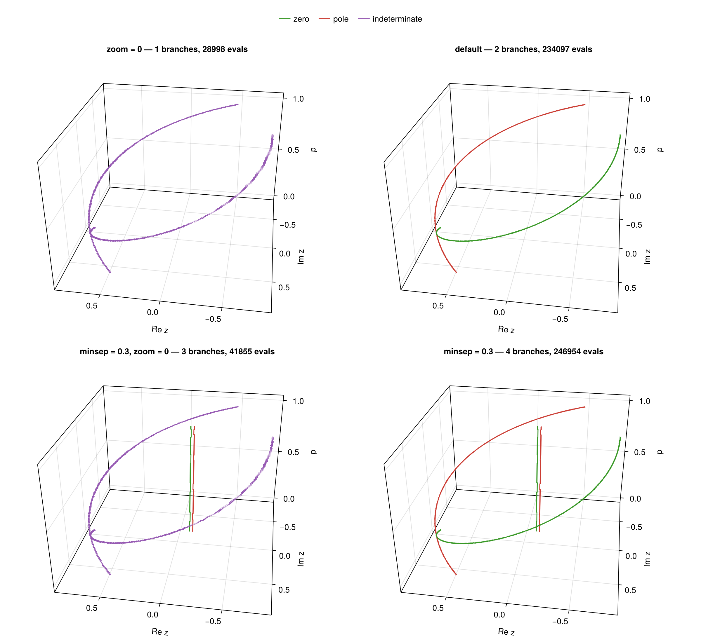

# MeromorphicLoci.jl

Find the zeros and poles of a [meromorphic](#branch-cuts) function of complex `z` inside a region — 
at fixed parameters, or as loci `z*(p)` traced over `m ≥ 0` parameters `p`.

```julia
findzeros(f, zdomain, alg)       # (; points, windings, unresolved, nevals, …)
findpoles(f, zdomain, alg)       # the same, for poles
findzeropoles(f, zdomain, alg)   # both, told apart by the sign of `windings`
findloci(f, zdomain, pdomain, alg)   # loci z*(p)
```

The point finders take `f(z)` and return

- `points` — each distinct zero or pole found, sorted by real then imaginary part;
- `windings` — the winding of `f` around each: its multiplicity, negative for a pole, or
  the count of simple ones closer together than the algorithm resolves;
- `unresolved` — places where a zero or pole was detected but its kind could not be told;
- `nevals` — the evaluations of `f` spent;

and fields particular to the algorithm. `findzeropoles` costs about as much as `findzeros`
or `findpoles` alone.

`findloci` takes `f(p...)` returning the function of `z`, and
returns a `Survey` of `Branch`es (below).

Two algorithms:

- **`ArgumentPrinciple(; zres, …)`** — adaptive cells over `(z, p...)`, refined
  only near the loci via Cauchy's argument principle. 
  z is refined to `zres`; `p` only as finely as the
  loci move. Loci come out connected and classified.
- **`AAA(; nsamples, tol, …)`** — rational fit of samples of `f(z)`, at fixed parameters only.

## Argument principle

`m = 1` parameter → loci are curves `z*(p)`; `m = 2` → surfaces `z*(p₁,p₂)`.

```julia
using MeromorphicLoci

# a zero and a pole winding around helices that graze at p ≈ 0.15 (0.004 apart),
# plus a fixed zero–pole pair 0.03 apart
f(p) = z -> (z - 0.80 * cispi(p)) * (z + 0.10 + 0.12im) /
            ((z - 0.804 * cispi(-p + 0.3)) * (z + 0.13 + 0.12im))
zbox = (-0.98 - 0.98im, 0.98 + 0.98im)  # opposite corners of the z-rectangle
pbox = ((0.0, 1.0),)                    # one (lo, hi) or knot vector per parameter
s = findloci(f, zbox, pbox, ArgumentPrinciple(zres = 0.02))  # zres: z-plane resolution
@assert length(s) == 2
zero_branch = only(b for b in s if winding(b) > 0)
pole_branch = only(b for b in s if winding(b) < 0)
```

A `Branch` is one locus `z*(p)`: its `Sample`s `(z, p...)` sorted by parameter, each
within about `zres` of the locus. `winding(b)` classifies it — `> 0` zero, `< 0` pole,
`0` indeterminate — with magnitude the multiplicity.

Two clean branches here take **escalation**: where the helices graze, closer than
`zres`, they fuse into one branch of winding 0, which is refined below `zres`, up to
`zoom` halvings, until it splits. `zoom = 0` turns this off:

```julia
@assert length(findloci(f, zbox, pbox, ArgumentPrinciple(zres = 0.02, zoom = 0))) == 1  # fused, winding 0
```

The fixed pair is missed in both: it sits closer than `minsep`, so a coarse cell holds
both and their windings cancel. A smaller `minsep` finds it:

```julia
@assert length(findloci(f, zbox, pbox, ArgumentPrinciple(zres = 0.02, minsep = 0.3, zoom = 0))) == 3
@assert length(findloci(f, zbox, pbox, ArgumentPrinciple(zres = 0.02, minsep = 0.3))) == 4  # default zoom = 4
```

(`minsep = 0.3 ≫ 0.03` catches the pair only because a cell boundary happens to fall
between its members; the guarantee needs `minsep < 0.03`.)



Without parameters, the point finders report each branch as one point, and winding-0
branches as `unresolved`:

```julia
r = findzeropoles(z -> (z - 0.3) * (z + 0.4im)^2 / (z - 0.6), (-1 - 1im, 1 + 1im),
                  ArgumentPrinciple(zres = 0.01))
@assert r.windings == [2, 1, -1] && isempty(r.unresolved)   # −0.4i, 0.3, 0.6
```

How it works: [docs/argument_principle.md](docs/argument_principle.md).
[RootsAndPoles.jl](https://github.com/fgasdia/RootsAndPoles.jl) implements SA-GRPF by
Delaunay triangulation for the `m = 0` problem; [benchmark/compare.jl](./benchmark/compare.jl)
surveys one 3-D box with one adaptive survey and with 128 independent 2-D RootsAndPoles slices.

## AAA

```julia
f(z) = (z^2 - 1) * (z - 0.5im) / (z - 2)
r = findzeros(f, (-3 - 1im, 3 + 1im), AAA())   # sampled evenly, about 320 points
Z = filter(z -> abs(z) < 1.5, range(-1.5, 1.5, 30) .+ im .* range(-1.5, 1.5, 30)')
r = findzeros(f, Z, AAA())                     # any sample points; loci wherever the fit puts them
```

`findzeros` fits `1/f` by AAA, reads candidate zeros off its poles (and poles of `f` off
its zeros), and confirms each candidate by the winding of `f` on a small circle around it,
which rejects spurious candidates and counts multiplicity (see the `AAA` docstring). `fitconverged = false` means the fit
stopped short of `tol` and may have missed loci.
See [docs/aaa.md](docs/aaa.md) for the fit, its cost and what it can miss;
`benchmark/aaa.jl` compares it against RationalFunctionApproximation.jl and
BaryRational.jl.

## Branch cuts

A cut in the region is not detected as such. `ArgumentPrinciple` reports it as one
`unresolved` (winding-0) locus when its phase jump skips a quadrant (`sqrt`), and
misses it silently otherwise (`cbrt`), along with any zero at its branch point.
`AAA` fills it with a string of interleaved zeros and poles.
