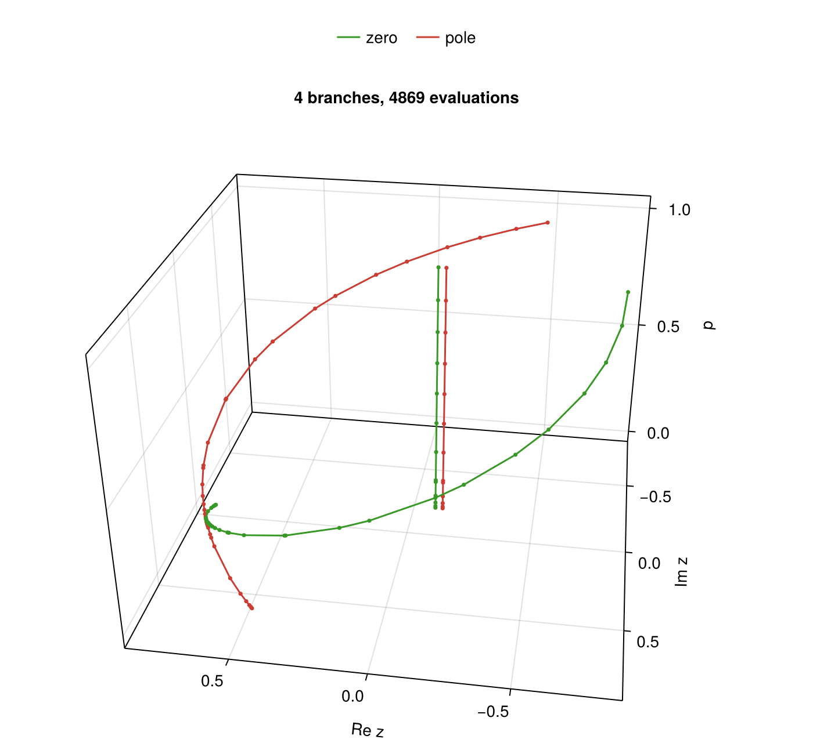

# MeromorphicLoci.jl

Find the zeros and poles of a meromorphic function `f(z)` in a box of the complex plane, 
at fixed parameters or as loci `z*(p)` that move with parameters `p`.

## Quickstart

```julia
using MeromorphicLoci

f(z) = (z^2 - 1) * (z - 0.5im) / (z - 2)
r = findzeropoles(f, (-3 - 1im, 3 + 1im), AAA())   # the box by opposite corners
# windings: > 0 for a zero, < 0 for a pole, |winding| = multiplicity
@assert r.points ≈ [-1, 0.5im, 1, 2] && r.windings == [1, 1, 1, -1]
```

Over a parameter, `findloci` takes `g(p...)` returning the function of `z`:

```julia
# a zero and a pole that circle the origin as p varies
# plus a fixed zero–pole pair
g(p) = z -> (z - 0.80 * cispi(p)) * (z + 0.10 + 0.12im) /
            ((z - 0.804 * cispi(-p + 0.3)) * (z + 0.13 + 0.12im))
zbox = (-0.98 - 0.98im, 0.98 + 0.98im)
pbox = ((0.0, 1.0),)                    # one (lo, hi) or vector of knots per parameter
s = findloci(g, zbox, pbox, AAA())
@assert sort([b.winding for b in s]) == [-1, -1, 1, 1]   # the moving pair and the fixed pair
# nothing missed or ambiguous
@assert isempty(s.deficit) && all(b -> isempty(b.uncertified), s)
```

`s` holds one `Branch` per locus: a vector of samples `x`, sorted by 
the parameter tuple `x.p`, with `x.z` on the locus.



## Interface

```julia
findzeros(f, zdomain, alg; polish, mapper)       # zeros of f(z)
findpoles(f, zdomain, alg; polish, mapper)       # poles
findzeropoles(f, zdomain, alg; polish, mapper)   # both, from one search
findloci(f, zdomain, pdomain, alg; mapper)       # loci z*(p) of zeros and poles of f(p...)(z)
```

The point finders return `(; points, windings, converged, unresolved, nevals, …)`;
`findloci` returns a `Survey` of `Branch`es (`?MeromorphicLoci.Survey`, `?MeromorphicLoci.Branch`).

## Algorithms

- **`AAA(; nsamples, tol, …)`** fits a rational function to samples of `f`. Use it first:
  it costs about `nsamples` evaluations plus a few dozen per point found, whatever the box
  size, where `ArgumentPrinciple` costs at least `2·area/minsep²`; and it resolves
  zero–pole pairs a few times closer than its sample spacing.
- **`ArgumentPrinciple(; zres, minsep, …)`** refines cells near the zeros and poles by the argument principle. Use it to
  cross-check `AAA` ([Checks and cost](#checks-and-cost)).
- **`Continuation(seed; …)`** runs the point finder `seed` at a few parameter values, the
  knots, and follows each locus between them with Muller's method. `findloci` with a
  point finder `alg` is short for `Continuation(alg)`.

## AAA

The fit, its cost and what it can miss: [aaa.md](docs/src/aaa.md). `benchmark/aaa.jl`
compares it with RationalFunctionApproximation.jl and BaryRational.jl.

## Continuation

The quickstart's moving pole passes 0.004 from the zero, yet their branches stay apart:
following tells loci apart down to `zfloor` (`?Continuation`), far below the sample
spacing; closer approaches are listed in `uncertified`. A nonempty `s.deficit` means the
count disagreed with the branches at some knot, or could not be read there.

Over several parameters, the knots form a grid: loci are found at its nodes and followed
along its lines.

```julia
# the pole surface passes 0.004–0.05 from the zero surface
h(p, q) = z -> (z - 0.8 * cispi(p)) / (z - (0.804 + 0.05q) * cispi(-p + 0.3))
s2 = findloci(h, zbox, ((0.0, 1.0), (0.0, 1.0)), AAA())
@assert sort([b.winding for b in s2]) == [-1, 1] && all(b -> b.degree == 1, s2)
```

Features confined to the inside of a grid cell go unseen; a finer grid resolves them.
How it works and what is certified: [continuation.md](docs/src/continuation.md).

## Argument principle

```julia
r = findzeropoles(z -> (z - 0.3) * (z + 0.4im)^2 / (z - 0.6), (-1 - 1im, 1 + 1im),
                  ArgumentPrinciple(zres = 0.01))
@assert r.windings == [2, 1, -1] && isempty(r.unresolved)   # −0.4i, 0.3, 0.6
@assert r.deficit == 0
```

Cells are refined down to `zres` wherever the phase of `f` winds around them, then grouped
and labelled by the winding of `f` around each group. A zero–pole pair closer than
`minsep` can be missed entirely: one coarse cell holds both, and their windings cancel. A
`minsep` below their separation finds it, at higher cost:

```julia
pair(z) = (z + 0.10 + 0.12im) / (z + 0.13 + 0.12im)   # 0.03 apart
@assert isempty(findzeropoles(pair, zbox, ArgumentPrinciple(zres = 0.02)).points)
@assert findzeropoles(pair, zbox, ArgumentPrinciple(zres = 0.02, minsep = 0.025)).windings == [-1, 1]
```

How it works: [argument_principle.md](docs/src/argument_principle.md).
[RootsAndPoles.jl](https://github.com/fgasdia/RootsAndPoles.jl) solves the same problem
with SA-GRPF on a Delaunay triangulation; [benchmark/compare.jl](./benchmark/compare.jl)
tracks the loci of a dispersion relation over a wavenumber range with one `findloci` call
and with 128 independent RootsAndPoles slices.

## Checks and cost

- **Completeness.** Every count is of zeros minus poles, so a zero and a pole missed
  together escape it. Factor out what you know, e.g. search `z -> f(z) * (z - a)` for the
  zeros beside a known pole `a`: fewer points to find, and fewer pairs to cancel.
  - `ArgumentPrinciple`: `r.deficit == 0 && isempty(r.unresolved)` leaves only pairs closer than `minsep` unfound.
  - `AAA`: no count; `r.fitconverged` says only that the fit met `tol` (`?AAA`).
    Cross-check with `ArgumentPrinciple` where a miss matters.
  - `Continuation`: counts at every knot with either point finder: `isempty(s.deficit)`.
    Otherwise raise `nsamples` for `AAA`, or lower `minsep` for `ArgumentPrinciple`.
- **Expensive thread-safe `f`.** Pass `mapper` an order-preserving threaded map, such as
  `tmap(f, xs) = fetch.([Threads.@spawn f(x) for x in xs])` or OhMyThreads.jl's `tmap`.
  `findloci` also calls `f(p...)` through it, which must then be thread-safe too.
  In `Continuation`, finding at the knots dominates the cost, and only knots discover loci: 
  if no locus enters the box, pass the knots `[lo, hi]`.

## Branch cuts

Neither point finder detects a branch cut as such. `ArgumentPrinciple` reports it as one
`unresolved` point if its phase jump skips a quadrant (`sqrt`), and otherwise misses it
silently (`cbrt`), along with any zero at its branch point. `AAA` fills it with a string
of interleaved zeros and poles.
